# 基于微信小程序的仓储管理系统r275i--论文

> 🎓 **计算机毕业设计 · 基于微信小程序的仓储管理系统r275i--论文**
>
> 本仓库只放**项目介绍 + 运行截图**（截图是站点带水印的原图，存在仓库 `images/` 里）。
>
> 👉 **完整可运行源码 / 数据库脚本 / 部署文档：[点我获取](https://geekcode.top/archives/%E5%9F%BA%E4%BA%8E%E5%BE%AE%E4%BF%A1%E5%B0%8F%E7%A8%8B%E5%BA%8F%E7%9A%84%E4%BB%93%E5%82%A8%E7%AE%A1%E7%90%86%E7%B3%BB%E7%BB%9Fr275i-%E8%AE%BA%E6%96%87?utm_source=github)**
>
> 💬 咨询微信：**ir9372**　|　🌐 更多项目：[极客代码 geekcode.top](https://geekcode.top/?utm_source=github)
>
> 📌 项目详情页：<https://geekcode.top/archives/%E5%9F%BA%E4%BA%8E%E5%BE%AE%E4%BF%A1%E5%B0%8F%E7%A8%8B%E5%BA%8F%E7%9A%84%E4%BB%93%E5%82%A8%E7%AE%A1%E7%90%86%E7%B3%BB%E7%BB%9Fr275i-%E8%AE%BA%E6%96%87?utm_source=github>

<table><td width="230" align="center"> <b>扫码加微信 ir9372</b></td><td valign="middle">📦 源码 = 项目介绍 + 全部运行截图 + 数据库 + 部署文档 👉 点上方任意截图，直接跳到 <b>极客代码 geekcode.top</b> 详情页</td></table>

---

<h1>基于微信小程序的仓储管理系统_r275i--论文</h1>
<h2>项目概述</h2>

本项目旨在构建一个基于微信小程序与 Java 后端的高效仓储管理系统，解决传统仓储管理中信息滞后、多端协同困难及数据孤岛问题。系统采用前后端分离架构，核心功能涵盖商品全生命周期管理（入库、出库、盘点）、供应商管理、货物采购流程以及员工权限管控。适用人群包括仓库管理员、普通员工及系统超级管理员。通过移动端小程序实现便捷的操作交互，结合 Web 后台进行全局配置与数据监控，提升了仓储作业的实时性与准确性。技术架构上，后端基于 Spring Boot 框架提供 RESTful API 服务，前端使用微信小程序原生或混合开发模式，数据库选用 MySQL，确保了系统的稳定性与可扩展性。

<h2>技术架构</h2>
<h3>1. 总体架构设计</h3>

系统采用典型的 B/S 架构与 C/S 架构相结合的模式。前端分为微信小程序客户端和 Web 管理后台，后端统一由 Java 应用服务器承载。所有业务逻辑集中在服务端处理，前端仅负责视图展示与用户交互，两者通过 HTTP/HTTPS 协议进行通信。

<a href="https://geekcode.top/archives/%E5%9F%BA%E4%BA%8E%E5%BE%AE%E4%BF%A1%E5%B0%8F%E7%A8%8B%E5%BA%8F%E7%9A%84%E4%BB%93%E5%82%A8%E7%AE%A1%E7%90%86%E7%B3%BB%E7%BB%9Fr275i-%E8%AE%BA%E6%96%87?utm_source=github" title="查看完整源码">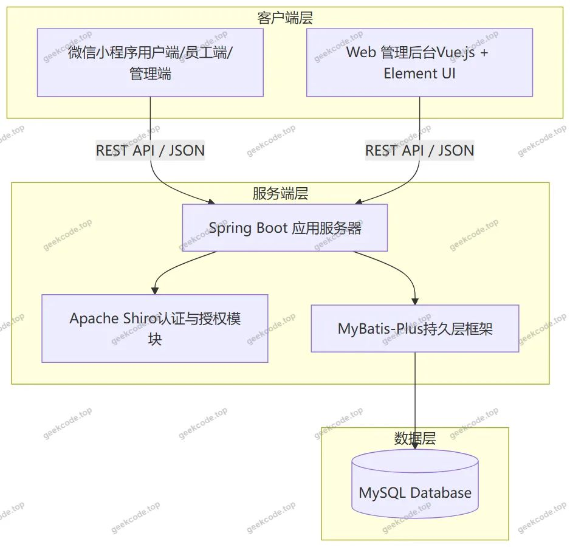</a>

<h3>2. 核心技术选型理由</h3>
<ul>
<li><strong>后端框架 (Spring Boot)</strong>：利用其自动配置特性简化开发流程，内置 Tomcat 容器便于部署，生态丰富，能快速集成各类中间件。</li>
<li><strong>安全框架 (Apache Shiro)</strong>：用于处理复杂的权限控制需求，支持会话管理和细粒度的访问控制，确保不同角色（如管理员、普通员工）只能访问授权范围内的资源。</li>
<li><strong>持久层框架 (MyBatis-Plus)</strong>：在 MyBatis 基础上增强 CRUD 操作，减少样板代码编写，支持分页插件和多表关联查询优化，提升数据库交互效率。</li>
<li><strong>前端交互 (REST API)</strong>：小程序与 Web 后台均通过标准的 RESTful 接口与后端交互，实现了跨平台的数据一致性，便于后续扩展至其他终端。</li>
</ul>
<h3>3. 数据库设计要点</h3>

数据库基于关系型模型设计，主要实体包括商品信息、供应商、员工、采购记录、出入库流水等。采用规范化设计以减少数据冗余，关键表之间通过外键建立关联。例如，“商品分类”表与“商品信息”表形成一对多关系，“供应商”表与“货物采购”表形成一对多关系。针对高频查询字段（如商品名称、供应商ID）建立索引以优化检索性能。

<h2>功能模块</h2>

根据提供的路由配置、Controller 列表及截图信息，系统功能划分为以下两大模块：

<h3>1. 微信小程序端功能</h3>

小程序端面向不同角色的用户提供差异化界面，具体包含以下页面和功能：

<ul>
<li>
<strong>公共基础模块</strong>

</li>
<li>
<strong>登录/注册</strong>：支持用户身份验证，区分普通用户、员工及管理端账号。

</li>
<li>
<strong>个人中心</strong>：显示用户基本信息，提供个人信息修改入口。

</li>
<li>
<strong>首页</strong>：聚合展示核心业务入口，如最新公告、快捷操作按钮等。

</li>
<li>
<strong>关于我们/系统简介</strong>：展示系统介绍及联系信息。

</li>
<li>
<strong>业务操作模块（员工/用户视角）</strong>

</li>
<li>
<strong>商品信息浏览</strong>：查看商品详情、分类及库存状态。

</li>
<li>
<strong>供应商货物查看</strong>：浏览特定供应商提供的货物清单。

</li>
<li>
<strong>货物采购列表</strong>：查看采购申请及进度状态。

</li>
<li>
<strong>在线沟通列表</strong>：处理与供应商或内部的即时通讯消息。

</li>
<li>
<strong>支付确认 (payconfirm)</strong>：涉及采购或交易环节的支付状态确认。

</li>
<li>
<strong>商品入库列表</strong>：执行或查看商品入库操作记录。

</li>
<li>
<strong>商品出库列表</strong>：执行或查看商品出库操作记录。

</li>
<li>
<strong>管理模块（管理员视角）</strong>

</li>
<li>
<strong>供应商管理</strong>：查看、编辑供应商信息列表。

</li>
<li>
<strong>员工管理</strong>：维护员工账户信息及权限分配。

</li>
<li>
<strong>商品分类管理</strong>：定义和维护商品的类别结构。

</li>
<li>
<strong>货物盘点</strong>：发起或查看库存盘点任务及结果。

</li>
<li>
<strong>公告信息管理</strong>：发布和管理系统通知。

</li>
<li>
<strong>关于我们管理</strong>：更新系统介绍内容。

</li>
<li>
<strong>系统简介管理</strong>：配置系统描述信息。

</li>
</ul>
<h3>2. Web 后台管理端功能</h3>

Web 后台主要服务于超级管理员，提供全面的数据管理与配置能力，对应 Controller 如下：

<ul>
<li>
<strong>系统配置模块 (<code>ConfigController</code>, <code>FileController</code>)</strong>

</li>
<li>
<strong>参数配置</strong>：管理系统运行所需的基础参数。

</li>
<li>
<strong>文件上传</strong>：处理图片、文档等非结构化数据的存储与管理。

</li>
<li>
<strong>基础数据管理模块</strong>

</li>
<li>
<strong>商品信息管理 (<code>ShangpinxinxiController</code>)</strong>：增删改查商品档案，关联分类与库存。

</li>
<li>
<strong>商品分类管理 (<code>ShangpinfenleiController</code>)</strong>：维护多级分类体系。

</li>
<li>
<strong>供应商管理 (<code>GongyingshangController</code>)</strong>：录入供应商资质、联系方式及合作状态。

</li>
<li>
<strong>员工管理 (<code>YuangongController</code>)</strong>：管理内部人员账号、部门归属及角色权限。

</li>
<li>
<strong>业务流程管理模块</strong>

</li>
<li>
<strong>货物采购管理 (<code>HuowucaigouController</code>)</strong>：审核采购订单，跟踪采购状态。

</li>
<li>
<strong>供应商货物管理 (<code>GongyingshanghuowuController</code>)</strong>：关联供应商与具体货物的供货关系。

</li>
<li>
<strong>商品入库管理 (<code>ShangpinrukuController</code>)</strong>：记录入库单据，更新库存数量。

</li>
<li>
<strong>商品出库管理 (<code>ShangpinchukuController</code>)</strong>：记录出库单据，扣减库存数量。

</li>
<li>
<strong>货物盘点管理 (<code>HuowupandianController</code>)</strong>：生成盘点单，对比账面库存与实际库存差异。

</li>
<li>
<strong>内容与互动模块</strong>

</li>
<li>
<strong>公告信息管理 (<code>NewsController</code>)</strong>：发布系统新闻、通知公告。

</li>
<li>
<strong>在线沟通管理 (<code>ZaixiangoutongController</code>)</strong>：查看和处理用户提交的咨询或留言。

</li>
<li>
<strong>关于我们管理 (<code>AboutusController</code>)</strong>：编辑前台展示的关于页面内容。

</li>
</ul>
<h2>用户角色与权限</h2>

系统基于 Apache Shiro 实现 RBAC（基于角色的访问控制）模型，主要划分为三类角色：

<table>
<thead>
<tr>
<th align="left">角色</th>
<th align="left">权限范围描述</th>
<th align="left">典型操作</th>
</tr>
</thead>
<tbody><tr>
<td align="left"><strong>超级管理员 (Admin)</strong></td>
<td align="left">拥有最高权限，可访问 Web 后台所有模块及小程序管理端功能。</td>
<td align="left">配置系统参数、管理所有用户（员工/供应商）、审核采购单、执行库存盘点、发布全站公告、删除任意数据记录。</td>
</tr>
<tr>
<td align="left"><strong>普通员工 (Employee)</strong></td>
<td align="left">仅限小程序端部分业务操作权限，无后台配置权。</td>
<td align="left">执行商品入库/出库操作、查看个人负责的采购列表、提交货物盘点数据、接收在线沟通消息、查看个人信息。</td>
</tr>
<tr>
<td align="left"><strong>普通用户/访客</strong></td>
<td align="left">受限的只读或基本交互权限，主要通过小程序访问。</td>
<td align="left">浏览商品信息、查看供应商货物、注册/登录、修改个人基本信息、发起在线沟通请求。</td>
</tr>
</tbody></table>

<em>注：Web 后台路由 <code>/admin</code> 暗示存在默认的管理员登录入口。小程序中的“管理端”页面组表明管理员也可通过移动端进行部分轻量级管理操作，但复杂配置仍依赖 Web 端。</em>

<h2>项目特色与创新点</h2>
<ol>
<li><strong>多端协同的工作流闭环</strong>：项目打破了传统仓储系统仅依赖 PC 端的局限，通过微信小程序将高频次的现场作业（如扫码入库、出库、盘点）移动化，同时保留 Web 端进行复杂的数据分析与全局配置，形成了“现场移动执行 + 办公室集中管理”的高效协同模式。</li>
<li><strong>细粒度的权限隔离机制</strong>：利用 Shiro 框架实现了从页面路由到 API 接口的双重权限校验。不同角色登录后看到的菜单和数据范围严格隔离，例如普通员工无法看到供应商结算金额，管理员才能进行货物盘点的最终审核，保障了数据安全。</li>
<li><strong>动态化的内容管理</strong>：系统将“公告”、“关于我们”、“系统简介”等内容模块化，支持后台实时更新并同步至前端，无需重新发布版本即可调整对外展示信息，提升了运营灵活性。</li>
<li><strong>标准化的 RESTful 接口设计</strong>：前后端完全解耦，后端仅提供标准 JSON 数据接口，不仅支持当前的 Vue 后台和微信小程序，也为未来扩展 Android/iOS App 或其他 IoT 设备接入奠定了良好的架构基础。</li>
</ol>
<h2>部署环境</h2>

为确保系统正常运行，需准备以下软硬件环境：

<h3>1. 硬件环境</h3>
<ul>
<li><strong>服务器</strong>：建议 CPU 4核以上，内存 8GB 以上，硬盘空间 50GB 以上（用于存储数据库及上传文件）。</li>
<li><strong>客户端</strong>：支持微信的小程序运行环境（手机或模拟器），主流浏览器（Chrome, Edge, Firefox 等）。</li>
</ul>
<h3>2. 软件环境</h3>
<ul>
<li><strong>操作系统</strong>：Windows 10/11 或 Linux (CentOS 7+, Ubuntu 20.04+)。</li>
<li><strong>Java 运行环境</strong>：JDK 1.8 或 JDK 11（推荐 JDK 1.8 以兼容现有依赖）。</li>
<li><strong>数据库</strong>：MySQL 5.7 或 MySQL 8.0（需启用 UTF-8mb4 字符集以支持 emoji 等特殊字符）。</li>
<li><strong>构建工具</strong>：Maven 3.6+（用于后端依赖管理）。</li>
<li><strong>前端环境</strong>：Node.js 14.x - 16.x（用于编译 Vue 后台及可能的小程序混合代码），npm/yarn/pnpm。</li>
<li><strong>开发工具</strong>：</li>
<li>IntelliJ IDEA 或 Eclipse（后端开发）。</li>
<li>Visual Studio Code（前端/Vue 开发）。</li>
<li>微信开发者工具（小程序调试与预览）。</li>
<li><strong>Web 服务器</strong>：Nginx（用于反向代理、静态资源托管及 HTTPS 配置）或直接使用 Spring Boot 内嵌 Tomcat。</li>
</ul>
<h2>五、技术特性</h2>
<ul>
<li>前后端集成部署，前端资源打包至后端 static 目录</li>
<li>使用 MyBatis-Plus 简化数据访问层开发</li>
<li>集成 Shiro 权限框架实现角色权限控制</li>
</ul>
<h2>六、功能模块截图</h2>
<h3>微信小程序用户端</h3>

<figure><a href="https://geekcode.top/archives/%E5%9F%BA%E4%BA%8E%E5%BE%AE%E4%BF%A1%E5%B0%8F%E7%A8%8B%E5%BA%8F%E7%9A%84%E4%BB%93%E5%82%A8%E7%AE%A1%E7%90%86%E7%B3%BB%E7%BB%9Fr275i-%E8%AE%BA%E6%96%87?utm_source=github" title="查看完整源码">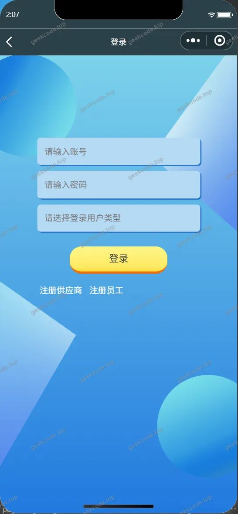</a><figcaption>小程序-登录</figcaption></figure>
<figure><a href="https://geekcode.top/archives/%E5%9F%BA%E4%BA%8E%E5%BE%AE%E4%BF%A1%E5%B0%8F%E7%A8%8B%E5%BA%8F%E7%9A%84%E4%BB%93%E5%82%A8%E7%AE%A1%E7%90%86%E7%B3%BB%E7%BB%9Fr275i-%E8%AE%BA%E6%96%87?utm_source=github" title="查看完整源码">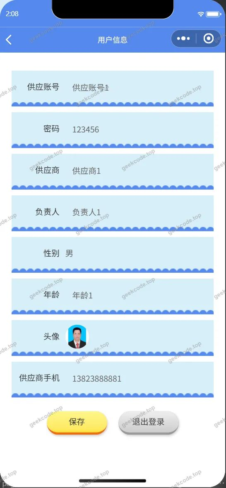</a><figcaption>小程序-个人信息</figcaption></figure>
<figure><a href="https://geekcode.top/archives/%E5%9F%BA%E4%BA%8E%E5%BE%AE%E4%BF%A1%E5%B0%8F%E7%A8%8B%E5%BA%8F%E7%9A%84%E4%BB%93%E5%82%A8%E7%AE%A1%E7%90%86%E7%B3%BB%E7%BB%9Fr275i-%E8%AE%BA%E6%96%87?utm_source=github" title="查看完整源码">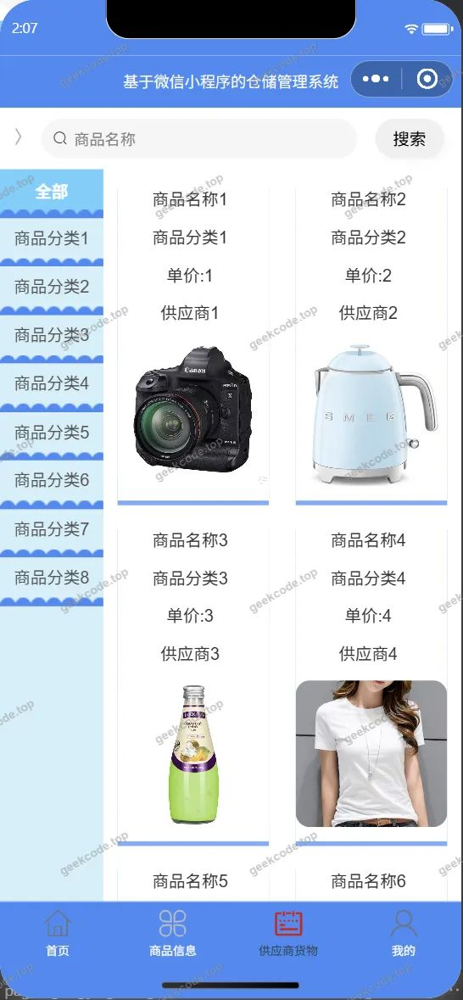</a><figcaption>小程序-供应商货物</figcaption></figure>
<figure><figcaption>小程序-货物采购列表</figcaption></figure>
<figure><figcaption>小程序-商品信息</figcaption></figure>
<figure><figcaption>小程序-首页</figcaption></figure>
<figure><a href="https://geekcode.top/archives/%E5%9F%BA%E4%BA%8E%E5%BE%AE%E4%BF%A1%E5%B0%8F%E7%A8%8B%E5%BA%8F%E7%9A%84%E4%BB%93%E5%82%A8%E7%AE%A1%E7%90%86%E7%B3%BB%E7%BB%9Fr275i-%E8%AE%BA%E6%96%87?utm_source=github" title="查看完整源码">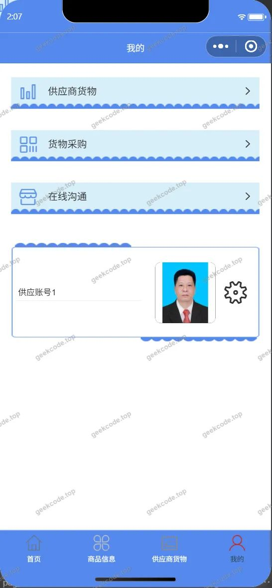</a><figcaption>小程序-我的</figcaption></figure>
<figure><a href="https://geekcode.top/archives/%E5%9F%BA%E4%BA%8E%E5%BE%AE%E4%BF%A1%E5%B0%8F%E7%A8%8B%E5%BA%8F%E7%9A%84%E4%BB%93%E5%82%A8%E7%AE%A1%E7%90%86%E7%B3%BB%E7%BB%9Fr275i-%E8%AE%BA%E6%96%87?utm_source=github" title="查看完整源码">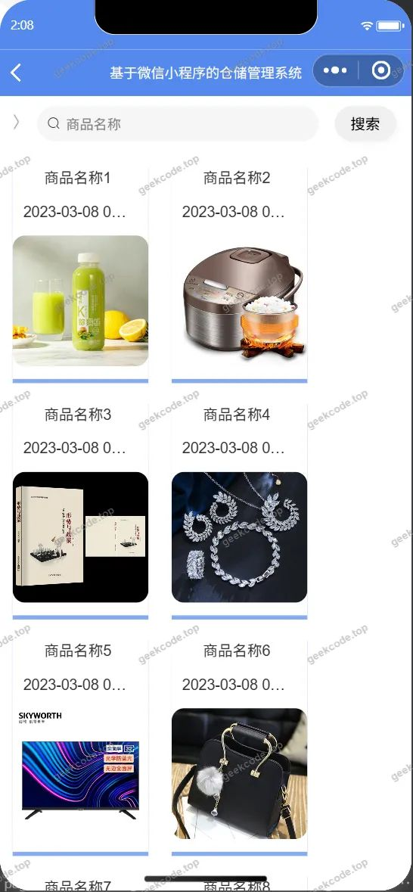</a><figcaption>小程序-在线沟通列表</figcaption></figure>
<figure><a href="https://geekcode.top/archives/%E5%9F%BA%E4%BA%8E%E5%BE%AE%E4%BF%A1%E5%B0%8F%E7%A8%8B%E5%BA%8F%E7%9A%84%E4%BB%93%E5%82%A8%E7%AE%A1%E7%90%86%E7%B3%BB%E7%BB%9Fr275i-%E8%AE%BA%E6%96%87?utm_source=github" title="查看完整源码">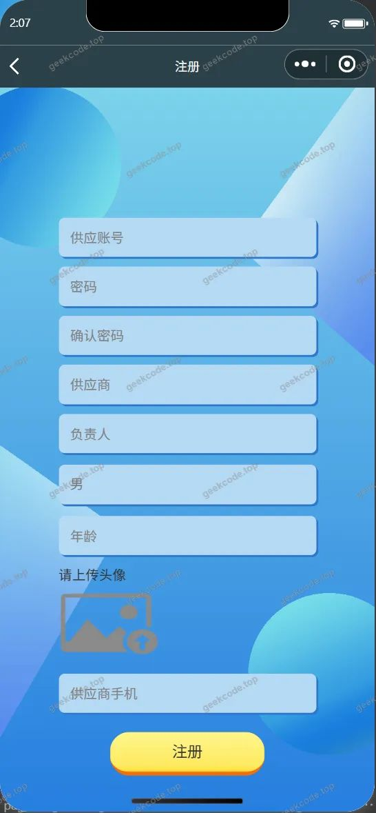</a><figcaption>小程序-注册</figcaption></figure>
<figure><a href="https://geekcode.top/archives/%E5%9F%BA%E4%BA%8E%E5%BE%AE%E4%BF%A1%E5%B0%8F%E7%A8%8B%E5%BA%8F%E7%9A%84%E4%BB%93%E5%82%A8%E7%AE%A1%E7%90%86%E7%B3%BB%E7%BB%9Fr275i-%E8%AE%BA%E6%96%87?utm_source=github" title="查看完整源码">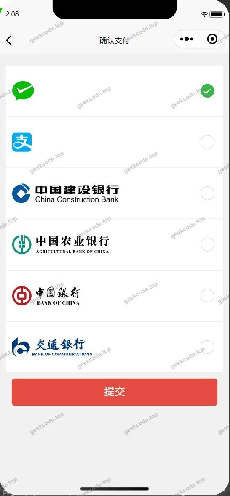</a><figcaption>小程序-payconfirm</figcaption></figure>

<h3>微信小程序管理端</h3>

<figure><a href="https://geekcode.top/archives/%E5%9F%BA%E4%BA%8E%E5%BE%AE%E4%BF%A1%E5%B0%8F%E7%A8%8B%E5%BA%8F%E7%9A%84%E4%BB%93%E5%82%A8%E7%AE%A1%E7%90%86%E7%B3%BB%E7%BB%9Fr275i-%E8%AE%BA%E6%96%87?utm_source=github" title="查看完整源码">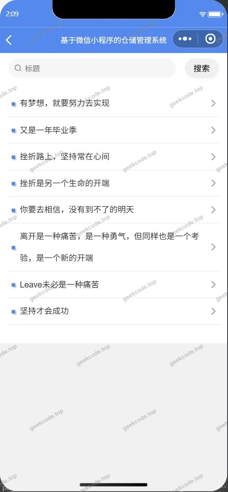</a><figcaption>小程序-管理端-公告信息列表</figcaption></figure>
<figure><figcaption>小程序-管理端-供应商列表</figcaption></figure>
<figure><figcaption>小程序-管理端-关于我们列表</figcaption></figure>
<figure><figcaption>小程序-管理端-货物盘点列表</figcaption></figure>
<figure><figcaption>小程序-管理端-商品分类列表</figcaption></figure>
<figure><figcaption>小程序-管理端-系统简介列表</figcaption></figure>
<figure><figcaption>小程序-管理端-员工列表</figcaption></figure>

<h3>微信小程序员工端</h3>

<figure><a href="https://geekcode.top/archives/%E5%9F%BA%E4%BA%8E%E5%BE%AE%E4%BF%A1%E5%B0%8F%E7%A8%8B%E5%BA%8F%E7%9A%84%E4%BB%93%E5%82%A8%E7%AE%A1%E7%90%86%E7%B3%BB%E7%BB%9Fr275i-%E8%AE%BA%E6%96%87?utm_source=github" title="查看完整源码">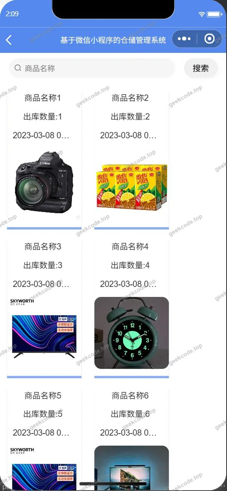</a><figcaption>小程序-员工-商品出库列表</figcaption></figure>
<figure><a href="https://geekcode.top/archives/%E5%9F%BA%E4%BA%8E%E5%BE%AE%E4%BF%A1%E5%B0%8F%E7%A8%8B%E5%BA%8F%E7%9A%84%E4%BB%93%E5%82%A8%E7%AE%A1%E7%90%86%E7%B3%BB%E7%BB%9Fr275i-%E8%AE%BA%E6%96%87?utm_source=github" title="查看完整源码">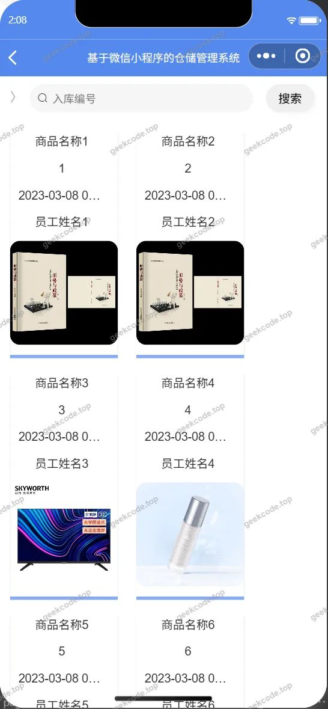</a><figcaption>小程序-员工-商品入库列表</figcaption></figure>

<h3>后台管理端</h3>
<h4>后台-登录页</h4>

<a href="https://geekcode.top/archives/%E5%9F%BA%E4%BA%8E%E5%BE%AE%E4%BF%A1%E5%B0%8F%E7%A8%8B%E5%BA%8F%E7%9A%84%E4%BB%93%E5%82%A8%E7%AE%A1%E7%90%86%E7%B3%BB%E7%BB%9Fr275i-%E8%AE%BA%E6%96%87?utm_source=github" title="查看完整源码">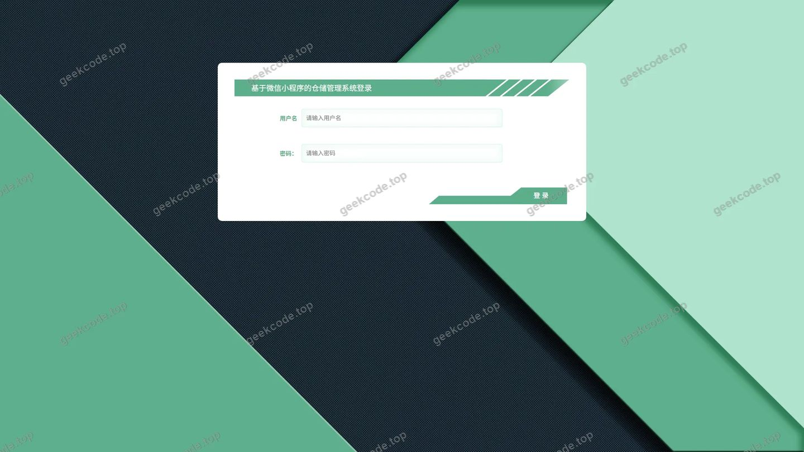</a>

<h4>后台-公告信息</h4>

<a href="https://geekcode.top/archives/%E5%9F%BA%E4%BA%8E%E5%BE%AE%E4%BF%A1%E5%B0%8F%E7%A8%8B%E5%BA%8F%E7%9A%84%E4%BB%93%E5%82%A8%E7%AE%A1%E7%90%86%E7%B3%BB%E7%BB%9Fr275i-%E8%AE%BA%E6%96%87?utm_source=github" title="查看完整源码">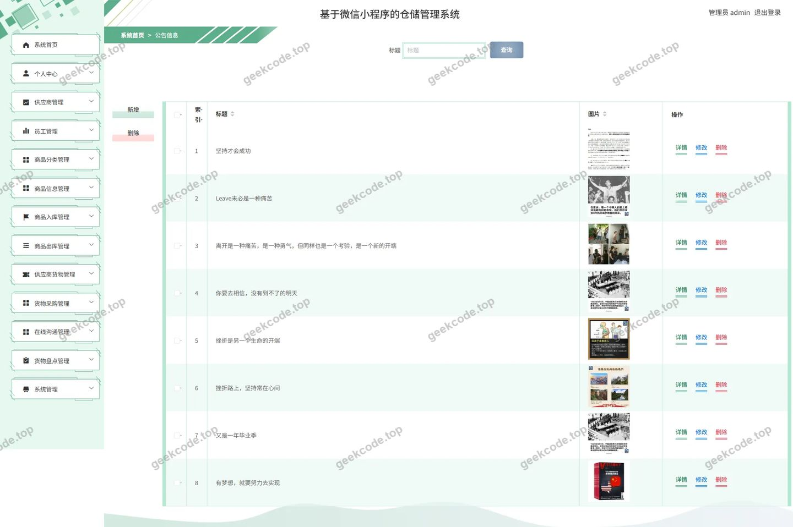</a>

<h4>后台-供应商</h4>

<a href="https://geekcode.top/archives/%E5%9F%BA%E4%BA%8E%E5%BE%AE%E4%BF%A1%E5%B0%8F%E7%A8%8B%E5%BA%8F%E7%9A%84%E4%BB%93%E5%82%A8%E7%AE%A1%E7%90%86%E7%B3%BB%E7%BB%9Fr275i-%E8%AE%BA%E6%96%87?utm_source=github" title="查看完整源码">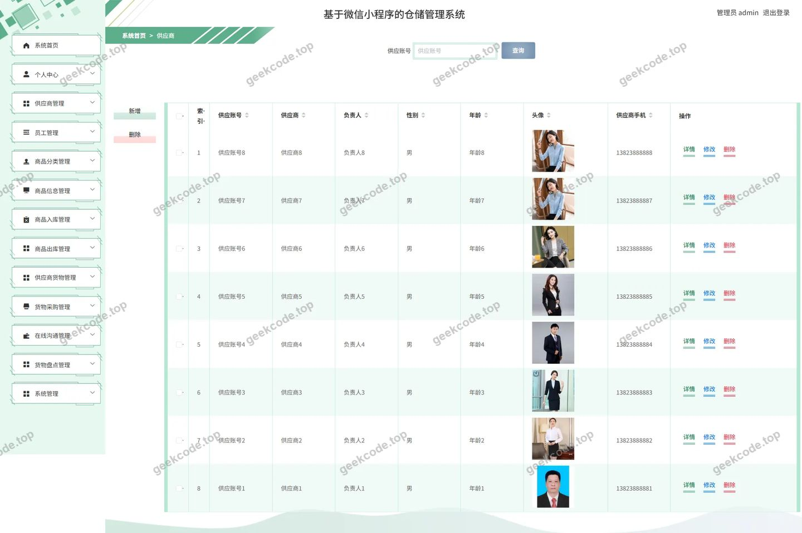</a>

<h4>后台-关于我们</h4>

<a href="https://geekcode.top/archives/%E5%9F%BA%E4%BA%8E%E5%BE%AE%E4%BF%A1%E5%B0%8F%E7%A8%8B%E5%BA%8F%E7%9A%84%E4%BB%93%E5%82%A8%E7%AE%A1%E7%90%86%E7%B3%BB%E7%BB%9Fr275i-%E8%AE%BA%E6%96%87?utm_source=github" title="查看完整源码">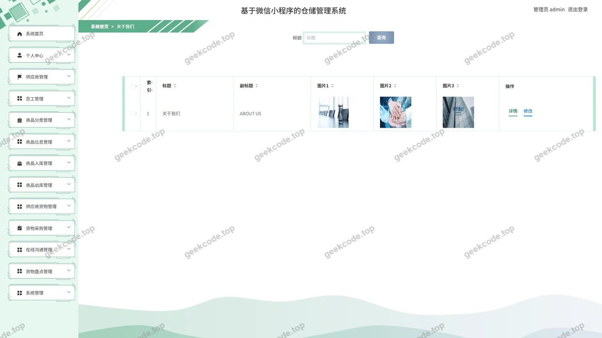</a>

<h4>后台-货物采购</h4>

<a href="https://geekcode.top/archives/%E5%9F%BA%E4%BA%8E%E5%BE%AE%E4%BF%A1%E5%B0%8F%E7%A8%8B%E5%BA%8F%E7%9A%84%E4%BB%93%E5%82%A8%E7%AE%A1%E7%90%86%E7%B3%BB%E7%BB%9Fr275i-%E8%AE%BA%E6%96%87?utm_source=github" title="查看完整源码">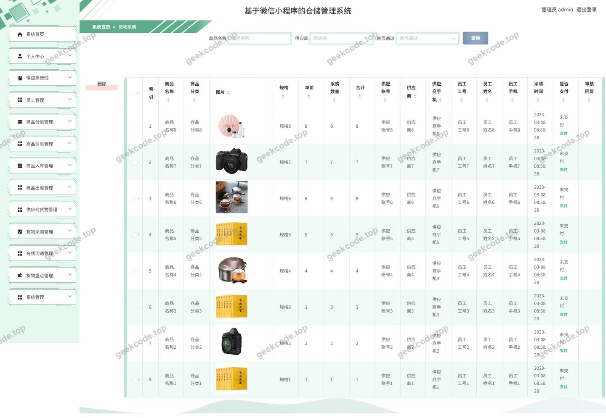</a>

<h4>后台-商品信息</h4>

<a href="https://geekcode.top/archives/%E5%9F%BA%E4%BA%8E%E5%BE%AE%E4%BF%A1%E5%B0%8F%E7%A8%8B%E5%BA%8F%E7%9A%84%E4%BB%93%E5%82%A8%E7%AE%A1%E7%90%86%E7%B3%BB%E7%BB%9Fr275i-%E8%AE%BA%E6%96%87?utm_source=github" title="查看完整源码">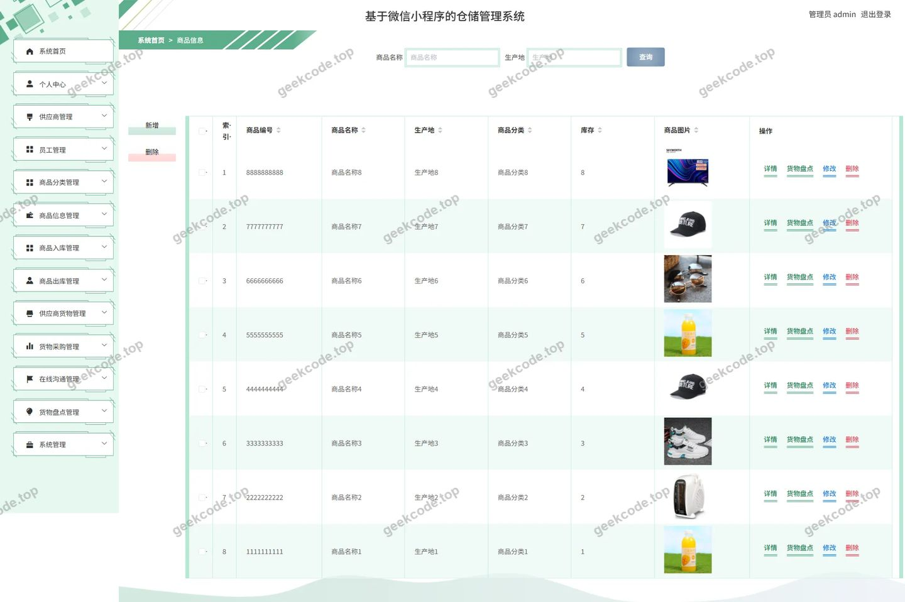</a>

<h4>后台首页</h4>

<a href="https://geekcode.top/archives/%E5%9F%BA%E4%BA%8E%E5%BE%AE%E4%BF%A1%E5%B0%8F%E7%A8%8B%E5%BA%8F%E7%9A%84%E4%BB%93%E5%82%A8%E7%AE%A1%E7%90%86%E7%B3%BB%E7%BB%9Fr275i-%E8%AE%BA%E6%96%87?utm_source=github" title="查看完整源码">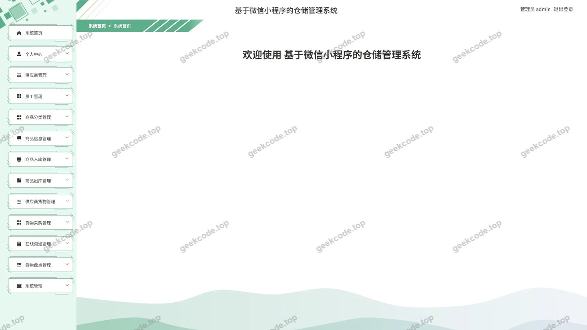</a>

<h4>后台-员工</h4>

<a href="https://geekcode.top/archives/%E5%9F%BA%E4%BA%8E%E5%BE%AE%E4%BF%A1%E5%B0%8F%E7%A8%8B%E5%BA%8F%E7%9A%84%E4%BB%93%E5%82%A8%E7%AE%A1%E7%90%86%E7%B3%BB%E7%BB%9Fr275i-%E8%AE%BA%E6%96%87?utm_source=github" title="查看完整源码">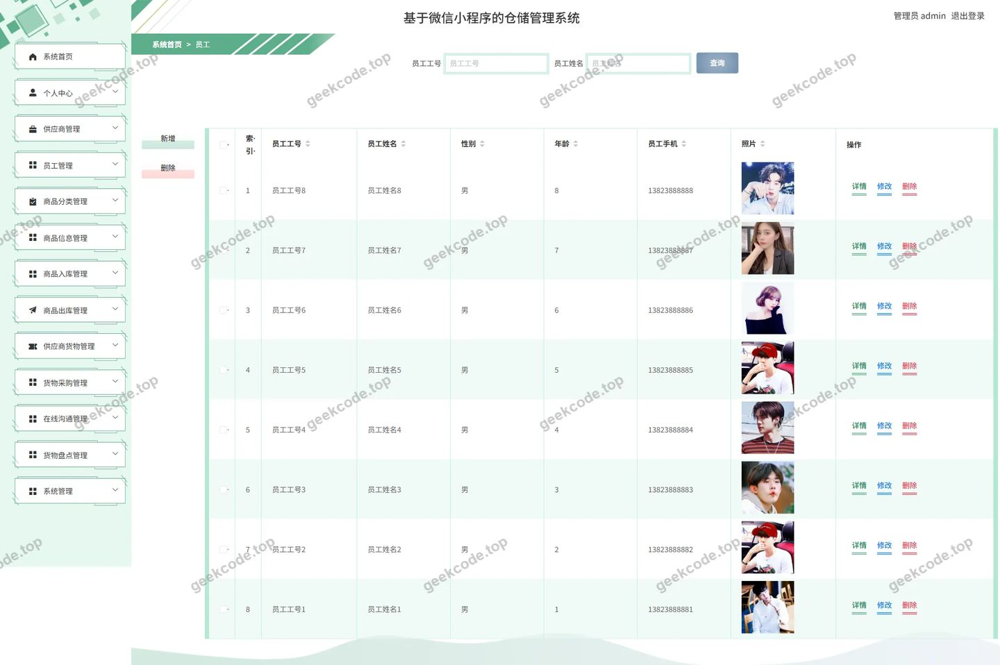</a>

---

## 获取完整源码

| 项目 | 说明 |
| --- | --- |
| 项目名 | 基于微信小程序的仓储管理系统r275i--论文 |
| 运行截图 | 本文 28 张（站点带水印原图，仓库 `images/` 目录） |
| 完整源码 | [https://geekcode.top/archives/%E5%9F%BA%E4%BA%8E%E5%BE%AE%E4%BF%A1%E5%B0%8F%E7%A8%8B%E5%BA%8F%E7%9A%84%E4%BB%93%E5%82%A8%E7%AE%A1%E7%90%86%E7%B3%BB%E7%BB%9Fr275i-%E8%AE%BA%E6%96%87?utm_source=github](https://geekcode.top/archives/%E5%9F%BA%E4%BA%8E%E5%BE%AE%E4%BF%A1%E5%B0%8F%E7%A8%8B%E5%BA%8F%E7%9A%84%E4%BB%93%E5%82%A8%E7%AE%A1%E7%90%86%E7%B3%BB%E7%BB%9Fr275i-%E8%AE%BA%E6%96%87?utm_source=github) |
| 咨询微信 | **ir9372**（备注：jingpin-yuanma） |
| 更多项目 | [极客代码 geekcode.top](https://geekcode.top/?utm_source=github) |

> 需要源码、部署、改配置、跑不起来等问题，加微信 ir9372 沟通，说明项目名即可。
